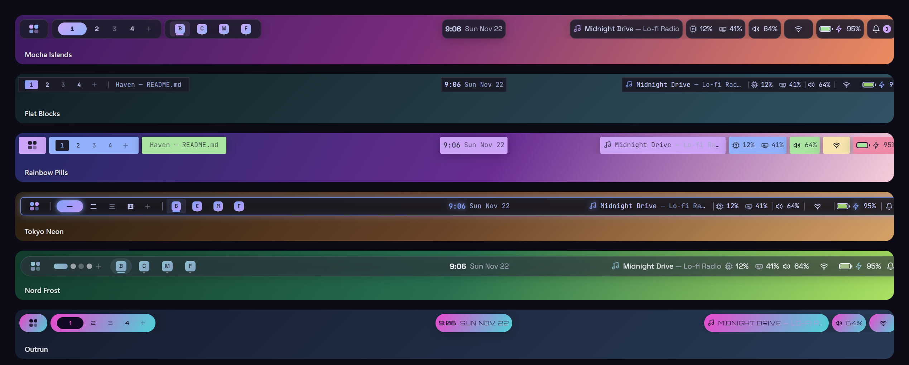
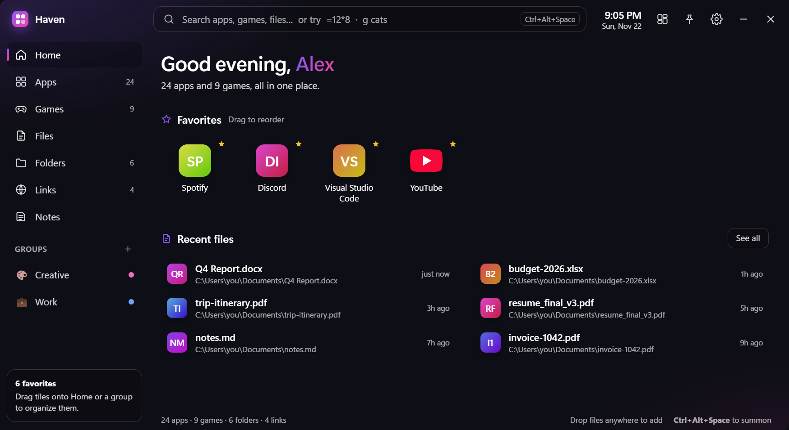
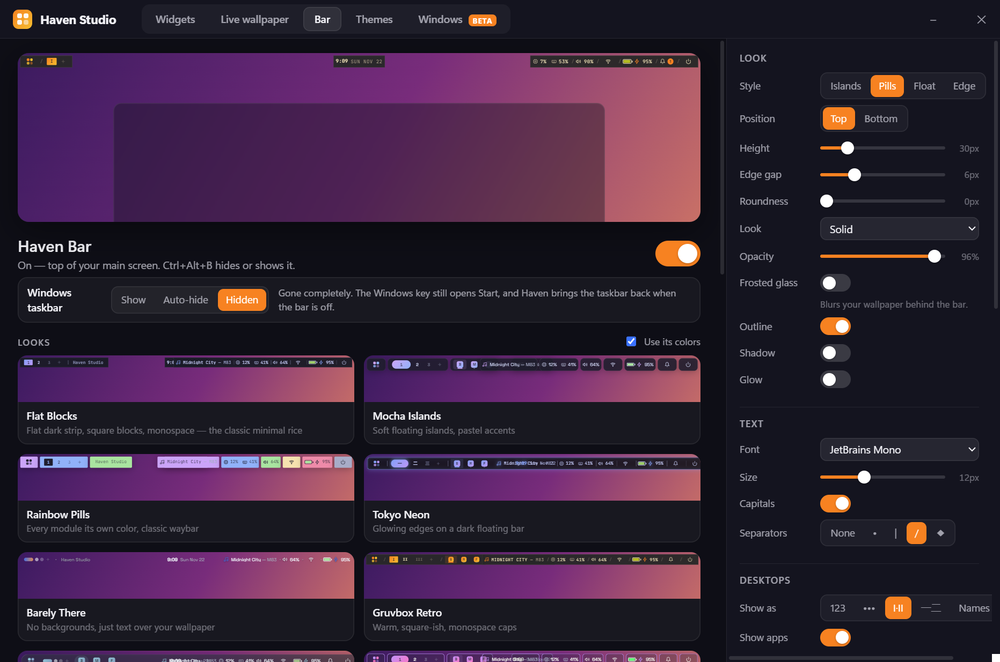
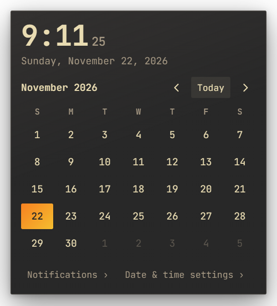
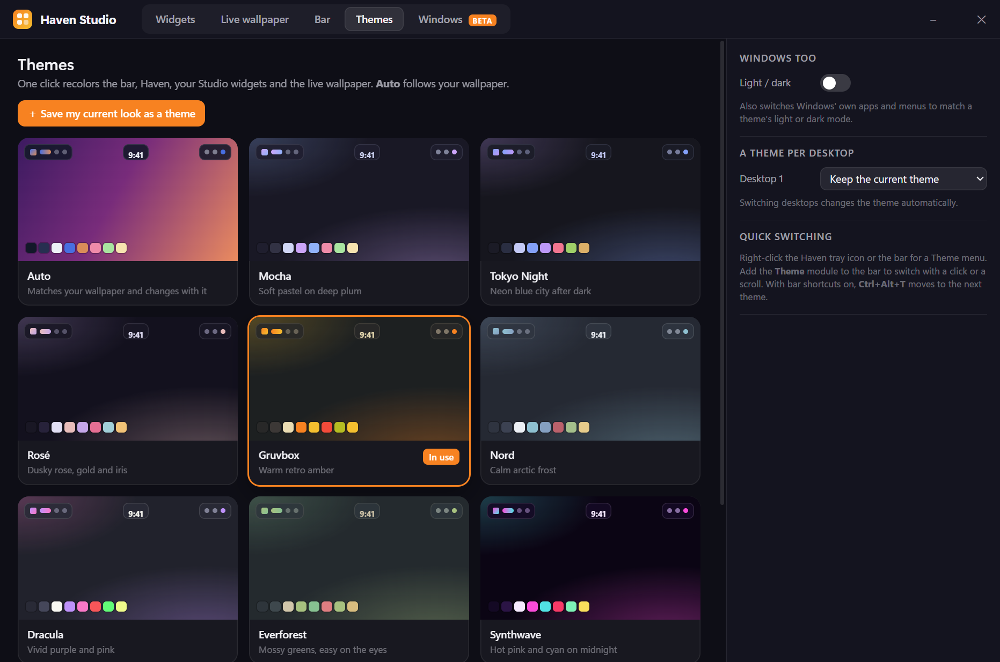
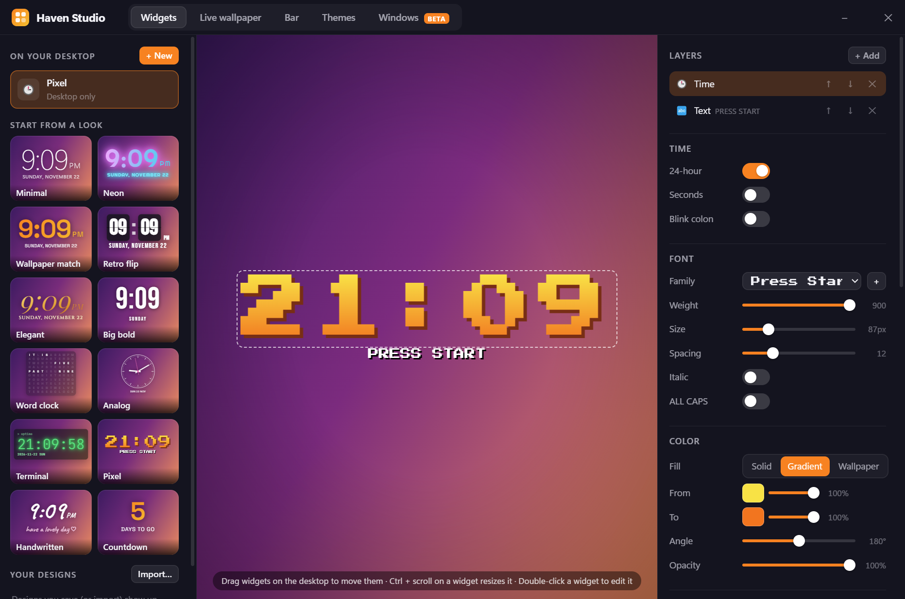
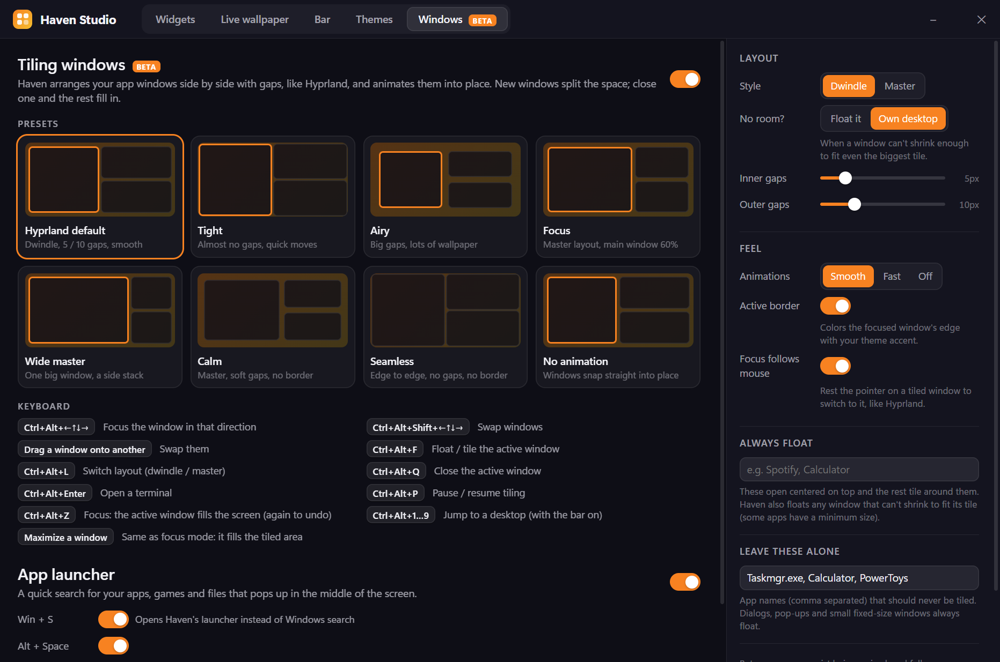
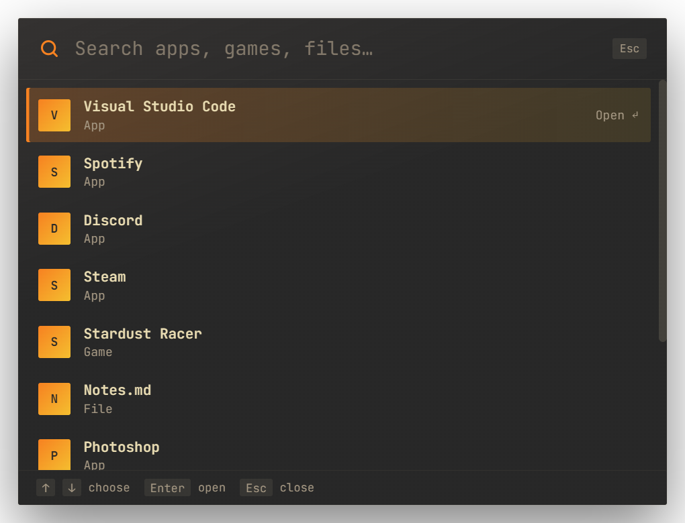

# Haven — your Windows desktop, your way

Haven turns the Windows desktop into something you design. It organizes your apps, games, files and links in glassy widgets. It adds a Hyprland-style status bar (HavenBar), creative clocks, live wallpapers and one-click themes, plus an optional tiling window manager (HavenTile). Colors follow your wallpaper automatically, or come from a theme you pick.



## Install

Download **`Haven-Setup-<version>.exe`** from the
[latest release](https://github.com/calebwilsonit-tech/WidgetHaven/releases/latest) and run it. It installs per-user (no admin needed), adds Desktop
and Start-menu shortcuts, and starts Haven when it's done. If you'd rather not install it, use
**`Haven-Portable-<version>.exe`** instead.

> The installer isn't code-signed yet, so Windows SmartScreen may say "Windows protected your PC".
> Click **More info → Run anyway**.

Haven updates itself: the installed version downloads new releases from GitHub in the background and installs them when it restarts (Settings → About).

Uninstall from **Settings → Apps → Installed apps → Haven**. Your favorites, groups, layouts and designs are kept in
`%APPDATA%\Haven`, so a reinstall or update picks up right where you left off.

## What's inside

### The hub and desktop widgets



- **Everything in one place:** Start-menu apps, Steam (with cover art), Epic, Microsoft Store/Xbox, desktop items and recent files are found automatically.
- **Search everything** (`Ctrl+Alt+Space` from anywhere): fuzzy and initials matching, a `=12*8` calculator, and `g` / `yt` / `w` / `r` / `gh` web searches.
- **Favorites and groups** with drag-and-drop ordering. Drop files from Explorer to add them; rename, hide, run as admin or add launch arguments.
- **Desktop widgets:** split the hub into separate widgets (Favorites, Apps, Games, Folders, any group), each with its own look.
  - Widgets sit behind your windows and survive Win+D.
  - They snap to screen edges, the center and each other, with smart guides and even gaps.
  - The gap to the screen edges matches the gap between widgets.
- **Layouts:** Grid, Side column, Bottom dock, Gamer, Focus and Corner, or save your own. Widgets refit themselves when the bar or taskbar changes the usable screen space.
- **Readable anywhere:** see-through widgets read the patch of wallpaper behind them and choose readable text.

### HavenBar



A status bar in the style of Hyprland and Waybar setups (`Ctrl+Alt+B` turns it on or off).

- **Desktop buttons** for your virtual desktops (click to jump, scroll to flip, + to add), plus open apps, the active window title, clock, now playing, CPU and memory, volume, network, battery, notifications and power.
- **21 ready-made looks**, from flat square blocks to rounded pills and neon glass. You can also build your own from styles (islands, pills, floating, edge to edge), looks (solid, colorful, outline, underline, minimal, neon, soft, brutalist, gradient, mono), fonts, separators and frosted glass. Drag modules between left, middle and right.
- **Haven's own panels** instead of the Windows flyouts:
  - **Clock:** a calendar.
  - **Notifications:** your real Windows notifications, with dismiss and clear-all animations.
  - **Network:** your Wi-Fi networks.
  - **Sound:** volume and what's playing.
  - **Battery:** battery details and brightness.
  - **CPU & memory:** usage and the apps using the most memory.
  - **Hidden icons:** your real tray icons with working left- and right-click (even with the taskbar hidden), plus apps running in the background to open or quit.
  - **Power:** lock, sleep, restart and shut down.
  - **Quick settings:** a control center.
- **Windows taskbar:** *Show*, *Auto-hide* or *Hidden*. It always comes back when the bar is off or Haven quits.
- The bar reserves its own strip of the screen, so maximized windows stop below it, and it hides for fullscreen games.
- **Match looks:** your desktop widgets can copy the bar's opacity, glass, outline, corners and font, or the bar can copy the widgets. The panels and launcher follow the bar's corners too.



### Themes



One click recolors the bar, Haven, your Studio widgets and the live wallpaper.

- **Auto** follows your wallpaper.
- **Built-in themes:** Mocha, Tokyo Night, Rosé, Gruvbox, Nord, Dracula, Everforest, Synthwave, Mono, Latte and Paper. Each has a matching live wallpaper.
- **Your own themes:** save your current look as a theme, including your wallpaper, live wallpaper and bar layout.
- **Per desktop:** give each virtual desktop its own theme.
- **Windows too:** optionally switch Windows' own light/dark mode to match.

### Haven Studio: creative widgets and live wallpaper



- **Design your own desktop widgets:** digital, analog, flip and word clocks, dates, countdowns and text. Use any font (12 are bundled, or add your own), gradients, glow and shadows.
  - Start from 12 looks, then save, export and share your designs.
  - Widgets anchor to the center, top middle or any corner and stay put.
- **Live wallpaper:** animated scenes (Aurora, Liquid, Synthwave, Night sky, Bokeh), rain, snow or fireflies over your own wallpaper, or a looping video or GIF. It runs behind your desktop icons and pauses for games and fullscreen apps.

### HavenTile (beta) and the launcher



HavenTile is Hyprland-style automatic tiling for Windows. It's off by default; turn it on in Studio → HavenTile, the tray menu or the bar's right-click menu.

- **Layouts and presets:** dwindle and master layouts with adjustable gaps, plus presets (Hyprland default, Tight, Airy, Focus, Wide master, Calm, Seamless, No animation).
- **Smooth movement:** windows glide into place, and the active window gets an accent border that fades in.
- **Focus follows mouse:** rest the pointer on a window to switch to it.
- **Focus mode** (`Ctrl+Alt+Z` or the maximize button): the active window fills the tiled area.
- **Apps with a minimum size**, like Steam, get room made for them. If there's truly no space, they float or go to a virtual desktop of their own (your choice).
- **Resize:** drag the edge between windows, or use `Ctrl+Alt+=` / `Ctrl+Alt+-` (and `Ctrl+Alt+0` to even out).
- **Keys:** `Ctrl+Alt+arrows` to move focus, add `Shift` to swap windows, `Ctrl+Alt+F` to float, `Ctrl+Alt+P` to pause, and drag a window onto another to swap them.
- **App window corners:** make every app window square, slightly rounded or rounded, or match the bar (works with tiling off too).
- **Low overhead:** it only does work when a window opens, closes or moves.



**App launcher:** `Win+S` (replacing Windows search, which you can switch back) or `Alt+Space` opens an animated search for your apps, games and files.

## Develop

```
npm install
npm start
```

> npm 11 blocks install scripts, so if `npm start` says "Electron failed to install correctly",
> run `npm install-scripts approve electron` and `npm install` again.

## Build the installer

```
npm run dist          # dist/Haven-Setup-<version>.exe + dist/Haven-Portable-<version>.exe
npm run icon          # regenerate build/icon.png if the logo changes
```

## Releasing a new version

1. Note the changes under a new heading in `CHANGELOG.md`.
2. `npm run release:patch` (fixes) or `npm run release:minor` (new features). This bumps the version in
   `package.json`, commits, tags it (e.g. `v1.0.1`) and builds the installers.
3. `git push --follow-tags`, then attach `Haven-Setup-<version>.exe`, its `.blockmap`, `latest.yml` and `Haven-Portable-<version>.exe` from `dist/` to the GitHub release for that tag. Installed copies read `latest.yml` to find updates, so always include it.

Data lives in `%APPDATA%\Haven`. The screenshots use sample data.

Bundled fonts are from Google Fonts / Fontsource and are licensed under the SIL Open Font License (see `src/renderer/fonts/OFL-LICENSES.txt`).
